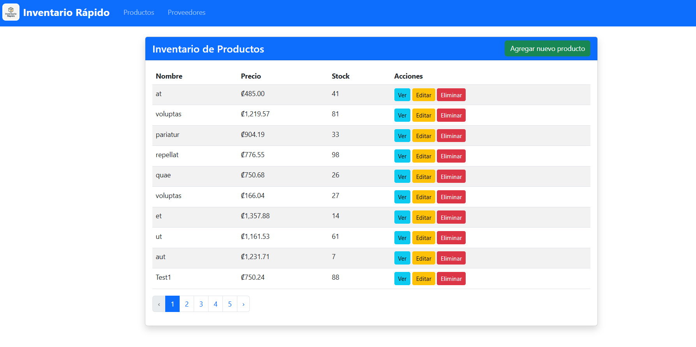

# Laravel Inventory Management System



A complete web-based inventory management system built with Laravel. It provides efficient management of products, suppliers, and categories through a responsive MVC application.

## Key Features

- **Complete product management:** Full CRUD operations for names, descriptions, purchase and sale prices, stock, and categorization
- **Supplier management:** Create and manage supplier records
- **Product categorization:** Organize products into categories for better inventory control
- **Responsive interface:** Adaptable layout for mobile and desktop devices
- **MVC architecture:** Implementation following Laravel development practices

## Technologies

- **Backend:** PHP 8.0+, Laravel 9.x
- **Database:** MySQL/SQLite
- **Frontend:** Blade Templates, HTML5, CSS3
- **Architecture:** MVC (Model-View-Controller)
- **ORM:** Eloquent
- **Database tooling:** Migrations and seeders

## Project Structure

### Controllers

- `ProductoController`: Product management operations
- `ProveedorController`: Supplier management operations

### Models

- `Producto`: Product model with category and supplier relationships
- `Proveedor`: Supplier model
- `Categoria`: Product category model

### Main Routes

- `/productos` - Product listing
- `/productos/create` - Create a product
- `/productos/{id}/edit` - Edit a product
- `/proveedores` - Supplier listing
- `/proveedores/create` - Create a supplier
- `/proveedores/{id}/edit` - Edit a supplier

## Installation

### Prerequisites

- PHP 8.0 or newer
- Composer
- MySQL or SQLite
- Web server such as Apache or Nginx

### Steps

1. **Clone the repository**

   ```bash
   git clone https://github.com/NikoCartin/InventarioRapidoLaravel.git
   cd InventarioRapidoLaravel
   ```

2. **Install dependencies**

   ```bash
   composer install
   ```

3. **Configure the environment**

   ```bash
   cp .env.example .env
   php artisan key:generate
   ```

4. **Configure the database**

   Edit `.env` with your database credentials:

   ```dotenv
   DB_CONNECTION=mysql
   DB_HOST=127.0.0.1
   DB_PORT=3306
   DB_DATABASE=inventario
   DB_USERNAME=your_user
   DB_PASSWORD=your_password
   ```

5. **Run migrations**

   ```bash
   php artisan migrate
   ```

6. **Run seeders (optional)**

   ```bash
   php artisan db:seed
   ```

7. **Start the development server**

   ```bash
   php artisan serve
   ```

## Using the System

### Product Management

- **Create:** Add products with complete information
- **List:** View products with pagination
- **Edit:** Update existing product information
- **Delete:** Remove products from inventory
- **View:** Review complete product details

### Supplier Management

- **Create:** Register suppliers
- **List:** View all suppliers
- **Edit:** Update supplier information
- **Delete:** Remove suppliers from the system

## Contributing

1. Fork the project.
2. Create a feature branch: `git checkout -b feature/new-feature`.
3. Commit your changes: `git commit -am 'Add new feature'`.
4. Push the branch: `git push origin feature/new-feature`.
5. Open a pull request.

## License

This project is released under the MIT License.

## Contact

- **Developer:** Nicolas Cartin Reyes
- **GitHub:** [@NikoCartin](https://github.com/NikoCartin)
